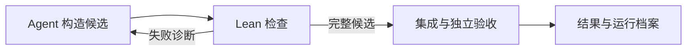

# TheoremOS

**可替换研究策略的数学 Agent 运行时。**

构造 Lean 证明、比较研究方法、复盘每一次尝试，由独立流程验收完整原题。

[](docs/releases/v0.1.0.md)
[](LICENSE)
[](https://bun.sh/)
[](https://nodejs.org/)

面向数学 Agent 研究者和 Lean 开发者。替换任务排序、上下文选择或协作策略中的一个组件，固定题目、环境、模型与预算开展对照实验，再从运行档案检查证明、失败原因和累计用量。

[产品官网](https://likc1606.github.io/theorem-os/) · [在线证明档案](https://likc1606.github.io/theorem-os/archive.html) · [快速体验](#快速体验) · [替换研究组件](examples/components/README.md) · [运行指南](docs/usage.md)

| 研究策略 | 证明验收 | 运行档案 |
| --- | --- | --- |
| 5 个可替换组件；单 Agent、独立并行与任务协作 | 固定原题与环境；集成后重新执行 Lean 检查 | 候选、诊断、会话、版本与用量；支持断点恢复 |



## 已验收证明

**3 个证明包有 Lean-Eval 官方通过记录。** 点击题目查看源码，点击结果核对官方回复。

| 题目 | 数学领域 | 官方结果 |
| --- | --- | --- |
| [Unit conjecture · 群环中的非平凡单位](accepted/annals_unit_conjecture/) | 代数 · 群环 | [#1246 · pass](https://github.com/leanprover/lean-eval-submissions/issues/1246#issuecomment-5380977645) |
| [Rademacher type and Enflo type coincide](accepted/annals_rademacher_enflo_type/) | 泛函分析 · 概率 | [#2115 · pass](https://github.com/leanprover/lean-eval-submissions/issues/2115#issuecomment-6161355838) |
| [Equiangular lines with a fixed angle](accepted/annals_equiangular_lines_fixed_angle/) | 组合数学 · 线性代数 | [#2135 · pass](https://github.com/leanprover/lean-eval-submissions/issues/2135#issuecomment-6186332699) |

成果来自前身 DeepScientist / DeepScientist Math 及其后续工作，包含复用早期证明的继续运行和环境迁移。它们是已归档的成功案例，不是当前版本从零求解的成功率评测。[成果档案](accepted/README.md)保留模型归因、题目版本、提交来源和 SHA-256 校验值。

另有 [Dimitrov、Hopf–Rinow 与 Szemerédi 三个研究中快照](in-progress/README.md)，可查看 Agent 工作区、研究记录与历史。它们尚未获官方验收，可能包含 `sorry` 和未完成路线，不计入上述通过数量。

<a id="快速开始"></a>

## 快速体验

先回放一道自然数加法小题，查看失败诊断和修复后的验收结果。候选证明是预设的，Lean 检查在本机真实执行，全程不调用模型。

需要 Linux、Git、Bun 1.2+、Node.js 22+、`/usr/bin/python3`、util-linux、Elan/Lean，以及允许创建用户命名空间的 Bubblewrap（`bwrap`）。这个回放不需要 Mathlib、FUSE 或模型认证。

```bash
git clone https://github.com/LikC1606/theorem-os.git
cd theorem-os
bun install --frozen-lockfile

# 只需准备一次 Lean
elan toolchain install leanprover/lean4:v4.33.0
bun run math doctor --lean-only

export THEOREMOS_CASE="$PWD/../theorem-os-runs/first-replay"
bun run math example replay --dir "$THEOREMOS_CASE"
bun run math inspect --run "$THEOREMOS_CASE/result.json"
```

`result.json` 中的 `example.source` 会注明这是预设回放。只有 `status: evaluated_passed` 表示完整题目通过；这个回放用于了解检查流程，不代表模型解题能力。

要让 Agent 自己证明这道小题，先按[小题示例](examples/getting-started/README.md)配置 Codex profile 和认证，再使用另一个新目录。`resume` 会调用模型并产生相应费用：

```bash
bun run math doctor
bun run math example prepare --dir "$PWD/../theorem-os-runs/model-run"
bun run math example check --dir "$PWD/../theorem-os-runs/model-run"
bun run math example resume --dir "$PWD/../theorem-os-runs/model-run"
```

模型小题默认使用单 Agent，最多 5 次调度和 5 分钟解题时间。真实公开题目还需要对应的 Mathlib 与 FUSE 环境，可继续看 [IMO2026 示例](examples/imo2026/README.md)；完整依赖与故障诊断见[运行指南](docs/usage.md)。

## 它解决什么问题

比较数学 Agent 的研究方法，需要控制模型、搜索策略和环境等变量。TheoremOS 提供组件接口和运行档案，便于设计对照实验：

| 你想回答的问题 | 如何开展实验或检查结果 |
| --- | --- |
| 这个搜索策略真的更好吗？ | 只替换一个组件，在固定题目、环境、模型和预算下进行对照实验 |
| 证明是否真的成立？ | 对完整原题执行独立 Lean 验收，模型完成消息不能跳过检查 |
| 实验能否复盘或恢复？ | 保存候选、诊断、会话、版本和累计用量，支持断点恢复 |
| 多个 Agent 如何协作？ | 任务依赖、角色分工、隔离工作区和审阅记录都写入运行档案 |

<a id="组件模型"></a>

## 五个可替换组件

一次求解会反复经历“选任务、整理上下文、尝试证明、检查结果、决定下一步”。TheoremOS 将这五类研究决策拆开，方便单独实验：

| 组件 | 负责什么 | 可以研究什么 |
| --- | --- | --- |
| M1 证明构造 | 调用模型并生成候选证明 | 证明生成方式、提示和修复策略 |
| M2 检查与反馈 | 检查候选并整理 Lean 诊断 | 错误反馈、局部验证和引理连接 |
| M3 搜索决策 | 选择下一步任务、重试或停止 | 任务排序、路线和预算分配 |
| M4 上下文选择 | 整理题目、成果和失败记录 | 上下文压缩、证据选择和检索 |
| M5 协作与复用 | 分配任务、审阅和复用成果 | Agent 角色、并行方式和交接协议 |

你可以运行单 Agent、独立并行尝试，或让多个 Agent 协作。组件与 Agent 数量无关：单个 Agent 也会用到多个组件，多个 Agent 可以共用一套组件。

用 `bun run math component init --name my-search` 生成 M3 模板后，即可修改任务排序函数，再运行 `bun run math component check --name my-search` 检查基本约定。完整接入步骤见[组件示例](examples/components/README.md)。

目前通过 TypeScript 源码接口替换组件，尚未提供稳定 SDK 或动态插件加载。运行时会保存组件版本，恢复运行时检查版本是否一致。

## 验证与结果

Agent 写出证明后，TheoremOS 会检查原题声明和受保护文件，运行 Lean，并在集成后重新验证全部原题目标。模型说“完成了”或同伴审阅通过，都不能代替最终检查。

结果保存在实验目录的 `result.json` 中。**只有 `status: evaluated_passed` 表示最终验收通过**；`prepared` 表示环境已准备好，`incomplete`、`limit_reached`、`evaluated_failed` 和 `runtime_error` 则需要结合诊断继续查看。

IMO2026 使用独立的本地 Lean 验收，记录为 `official: false`；Lean-Eval 使用其官方比较器。检查记录、失败反馈、任务计划和累计用量都会保存，方便恢复和复查。

如果要比较单 Agent、独立并行和协作的效果，可以使用[三组对照实验](examples/imo2026/COMPARISON.md)。目前尚无证据表明协作一定更快或更容易解出题目；组件的效果需要通过具体实验判断。

## 架构与开发

想读代码，可以从 [SolverModules](src/solver/modules/index.ts) 看五个组件的接口与默认组合，再看 [run.ts](src/solver/run.ts) 如何准备和验收一次运行。[组件示例](examples/components/README.md) 展示了如何把自己的实现接进去。

欢迎贡献新的组件策略、题目适配器，以及可复现的问题和实验。提交问题时，请附上运行命令、依赖版本、结果状态和相关诊断，并移除认证信息。

开发时常用的命令：

```bash
bun run test
bun run typecheck
bun run build
```

测试使用本地 fixture 和模拟会话，不调用真实模型。参数、断点恢复、人工计划修改、批量运行和协作协议见[运行指南](docs/usage.md)。

当前发布为 [v0.1.0 Research Preview](https://github.com/LikC1606/theorem-os/releases/tag/v0.1.0)，适合尝试研究思路和源码扩展。跨任务学习尚未实现，版本范围与限制见[发布说明](docs/releases/v0.1.0.md)。

## 许可证与致谢

Copyright 2026 TheoremOS contributors。

本项目从 DeepScientist 的数学证明运行时抽取，使用 [AGPL-3.0-only](LICENSE)；来源与第三方声明见 [NOTICE](NOTICE)。保留独立许可证声明的文件遵循其各自条款。

项目原名 DeepScientist Math，目前仍保留 `deepscientist-math` CLI 别名、`bun run math` 以及已有环境变量和配置路径，方便继续使用已有实验。

感谢 [Lean](https://lean-lang.org/)、[Mathlib](https://github.com/leanprover-community/mathlib4)、[Humanfia IMO2026](https://github.com/humanfia/imo2026) 与 [Lean-Eval](https://github.com/leanprover/lean-eval) 提供的形式化工具、数学库和公开评测资源。
