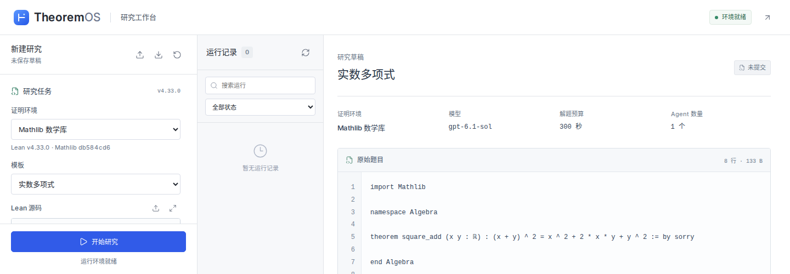
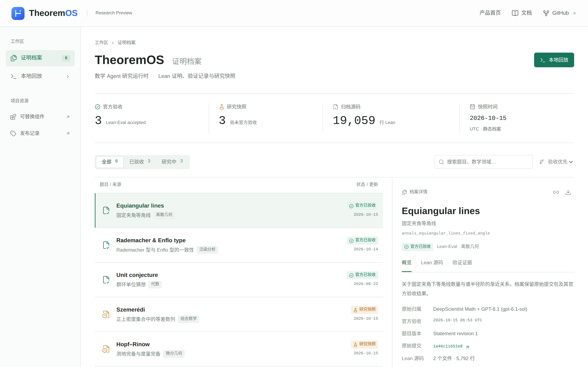
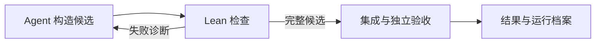

<div align="center">


<h1>TheoremOS</h1>

<p><strong>让数学 Agent 构造证明，由 Lean 独立验收完整原题。</strong></p>
<p>面向数学 Agent 研究者与 Lean 开发者的可组合运行时。</p>

[](docs/releases/v0.1.0.md) [](docs/web-workbench.md) [](LICENSE)

<p>
  <a href="https://likc1606.github.io/theorem-os/"><strong>产品官网</strong></a> ·
  <a href="https://likc1606.github.io/theorem-os/archive.html">证明档案</a> ·
  <a href="#快速开始">快速开始</a> ·
  <a href="docs/usage.md">使用文档</a> ·
  <a href="https://likc1606.github.io/theorem-os/feedback.html">反馈与建议</a>
</p>

</div>

<a href="docs/assets/workbench-full-desktop.png">
  <picture>
    <source media="(max-width: 640px)" srcset="docs/assets/workbench-mobile.png">
    
  </picture>
</a>

<p align="center"><sub>真实工作台截图 · Mathlib 草稿，尚未提交 · <a href="docs/assets/workbench-full-desktop.png">桌面原图</a> · <a href="docs/assets/workbench-full-mobile.png">手机原图</a></sub></p>

输入 Lean 原题，使用自己的 API Key 开始研究，查看候选证明和验收报告。研究者还可以替换搜索、上下文或协作策略，在固定题目、环境、模型与预算下开展对照实验。

## 选择你的入口

| 你想做什么 | 从这里开始 | 需要准备 |
| --- | --- | --- |
| 先了解产品与成果 | [产品官网](https://likc1606.github.io/theorem-os/) · [证明档案](https://likc1606.github.io/theorem-os/archive.html) | 浏览器即可 |
| 输入自己的 Key，提交 Lean 原题 | [部署网页工作台](#网页工作台) | Linux、Docker、API Key |
| 看一次失败、修复与验收 | [预设 Lean 回放](#快速体验) | 本机 Lean 环境，无需 API Key |
| 研究自己的 Agent 策略 | [替换研究组件](#五个可替换组件) · [CLI 指南](docs/usage.md) | 本地开发环境；模型运行需认证 |

> [!NOTE]
> GitHub Pages 托管静态官网和证明档案。提交任务、调用模型和运行 Lean，需要在 Linux 本地或服务器部署网页工作台。

## 已验收证明

仓库收录了 **10 个具有 Lean-Eval 官方通过记录的证明包**。题目链接指向归档源码，结果链接指向官方回复。

| 题目 | 数学领域 | 官方结果 |
| --- | --- | --- |
| [Unit conjecture · 群环中的非平凡单位](accepted/annals_unit_conjecture/) | 代数 · 群环 | [#1246 · pass](https://github.com/leanprover/lean-eval-submissions/issues/1246#issuecomment-5380977645) |
| [Rademacher type and Enflo type coincide](accepted/annals_rademacher_enflo_type/) | 泛函分析 · 概率 | [#2115 · pass](https://github.com/leanprover/lean-eval-submissions/issues/2115#issuecomment-6161355838) |
| [Equiangular lines with a fixed angle](accepted/annals_equiangular_lines_fixed_angle/) | 组合数学 · 线性代数 | [#2135 · pass](https://github.com/leanprover/lean-eval-submissions/issues/2135#issuecomment-6186332699) |
| [Fractional expectation thresholds · 分数期望阈值](accepted/annals_fractional_expectation_thresholds/) | 概率组合 | [#2141 · pass](https://github.com/leanprover/lean-eval-submissions/issues/2141#issuecomment-6197783762) |
| [Dimitrov · 代数整数的 house 下界](accepted/dimitrov/) | 代数数论 | [#2143 · pass](https://github.com/leanprover/lean-eval-submissions/issues/2143#issuecomment-6215093969) |
| [Hopf–Rinow · 测地完备与度量完备](accepted/hopf_rinow/) | 微分几何 | [#2143 · pass](https://github.com/leanprover/lean-eval-submissions/issues/2143#issuecomment-6215093969) |
| [Sunflower · 向日葵引理改进界](submitted/annals_improved_bounds_sunflower_lemma/) | 组合数学 | [#2144 · pass](https://github.com/leanprover/lean-eval-submissions/issues/2144) |
| [Lorentzian polynomials](submitted/annals_lorentzian_polynomials/) | 代数组合 | [#2144 · pass](https://github.com/leanprover/lean-eval-submissions/issues/2144) |
| [The optimal paper Möbius band](submitted/annals_optimal_moebius/) | 几何 | [#2144 · pass](https://github.com/leanprover/lean-eval-submissions/issues/2144) |
| [Algebraic integers](submitted/annals_algebraic_integers/) | 代数数论 | [#2144 · pass](https://github.com/leanprover/lean-eval-submissions/issues/2144) |

这些成果来自前身 DeepScientist / DeepScientist Math 及后续工作，包含复用早期证明的继续运行和环境迁移，不构成当前版本从零求解的成功率评测。[早期成果档案](accepted/README.md)与 [#2144 证明档案](submitted/README.md)保留模型归因、题目版本、提交来源和 SHA-256 校验值。

[定理知识库](docs/theorem-knowledge.md)可将这些证明包及运行中已检查的辅助定理导入统一索引，供 Agent 按需搜索完整类型、前提、依赖和源码；跨题复用仍需重新通过 Lean 检查。

后四题于 2026 年 10 月 16 日在 [Lean-Eval 提交 #2144](https://github.com/leanprover/lean-eval-submissions/issues/2144) 获得官方托管评测 4/4 通过。证明包仍保留在原提交归档目录，目录名不表示当前验收状态。

[OpenAI math 求解成果](results/openai-math/README.md)另收录 Truffet 有限反例的完整原题证明及本地原比较器验证证据；尚无 OpenAI 托管验收记录，难度 D 为本项目评估。

<details>
<summary>预览证明档案与历史研究快照</summary>

<a href="https://likc1606.github.io/theorem-os/archive.html">
  <picture>
    <source media="(max-width: 640px)" srcset="docs/assets/archive-preview-mobile.png">
    
  </picture>
</a>

[在线档案](https://likc1606.github.io/theorem-os/archive.html)可搜索、筛选题目，查看 Lean 源码和验收证据，并下载公开记录；当前展示早期 6 道已验收题目。#2144 的 4 道证明见上表和[提交归档](submitted/README.md)。

[历史研究快照](in-progress/README.md)保留 Dimitrov、Hopf–Rinow 与 Szemerédi 的 Agent 工作区、研究记录与历史。其中前两题已有上述最终验收包，Szemerédi 尚未获官方验收；历史草稿可能包含 `sorry` 和未完成路线。

</details>

## 快速开始

### 网页工作台

在浏览器中提交原题、查看研究进度、对比候选源码，并下载证明和验收报告。支持 OpenAI 及兼容 Responses API 的服务；仅提供 Chat Completions 的服务暂不支持。

需要 Linux、Docker Engine / Compose，宿主机允许创建用户命名空间；Mathlib 还需要 `/dev/fuse`。在本地启动：

```bash
git clone https://github.com/LikC1606/theorem-os.git
cd theorem-os
docker compose -f apps/web/compose.yml build worker web
docker compose -f apps/web/compose.yml up -d web
```

打开 <http://127.0.0.1:8787>，选择证明环境和模板，填写自己的 API Key。默认连接宿主机 8080 端口的 Sub2API，模型为 `deepseek-flash`、推理强度为 `max`；也可选择 OpenAI 并填写其支持的模型。默认使用 Mathlib，也可切换为 Lean 标准库；页面会显示固定的 Lean 工具链和 Mathlib 版本。

<details>
<summary>资源要求、API Key 与运行记录</summary>

- Mathlib 每次运行的内存上限为 8 GiB，标准库为 4 GiB；建议每个并发 Mathlib 运行预留 30 GiB 可用磁盘。首次构建需下载大型依赖和预编译缓存。
- Mathlib 冷准备最长 600 秒，准备与最终验收均不计入解题预算。轮次和时间限制不等于 API 费用上限。
- Key 由使用者提供；浏览器不会将其写入本地存储，服务也不会将其写入任务档案或日志。提交成功后清空输入框。
- 网页历史仅保存在服务内存，服务重启或会话过期后清空，暂不支持运行恢复。需要保留的证明与 JSON 请下载；CLI 提供持久运行档案与断点恢复。

标准库与 Mathlib 已通过真实容器和 Lean 检查，验证使用模拟模型，不产生 API 费用。不同服务商的实际 API 兼容性需使用对应账户验证。

服务商配置、完整功能范围、容器验证和服务器部署见[网页工作台指南](docs/web-workbench.md)。

</details>

<a id="快速体验"></a>

### 预设 Lean 回放

无需模型认证，先看一道自然数加法小题如何经历错误候选、Lean 诊断和修复验收。候选证明是预设的，Lean 检查在本机真实执行。

需要 Linux、Git、[Bun 1.2+](https://bun.sh/)、[Node.js 22+](https://nodejs.org/)、`/usr/bin/python3`、util-linux、Elan/Lean，以及允许创建用户命名空间的 Bubblewrap（`bwrap`）。此回放不需要 Mathlib 或 FUSE。

在仓库根目录执行；尚未克隆仓库时，先执行上方的 `git clone` 和 `cd`：

```bash
bun install --frozen-lockfile

# 只需准备一次 Lean
elan toolchain install leanprover/lean4:v4.33.0
bun run math doctor --lean-only

export THEOREMOS_CASE="$PWD/../theorem-os-runs/first-replay"
bun run math example replay --dir "$THEOREMOS_CASE"
bun run math inspect --run "$THEOREMOS_CASE/result.json"
```

`result.json` 的 `example.source` 会注明预设回放；最终状态 `evaluated_passed` 表示本机对完整题目的验收通过。此示例展示检查流程，不代表模型解题能力，也不是官方评测。

<details>
<summary>让 Agent 自己证明这道小题</summary>

先按[小题示例](examples/getting-started/README.md)配置 Codex profile 和认证，再使用另一个新目录。`prepare` 和 `check` 不调用模型；`resume` 会调用模型并产生相应费用：

```bash
bun run math doctor
bun run math example prepare --dir "$PWD/../theorem-os-runs/model-run"
bun run math example check --dir "$PWD/../theorem-os-runs/model-run"
bun run math example resume --dir "$PWD/../theorem-os-runs/model-run"
```

模型小题默认使用单 Agent，最多 5 次调度和 5 分钟解题时间。真实公开题目还需要对应的 Mathlib 与 FUSE 环境，见 [IMO2026 示例](examples/imo2026/README.md)；完整依赖与故障诊断见[运行指南](docs/usage.md)。

</details>

## 验证与结果

Agent 的完成消息、局部检查和同伴审阅都不能代替完整原题验收。TheoremOS 固定题目和环境，检查原题声明及受保护文件，并在证明集成后重新执行独立 Lean 检查。



**只有 `status: evaluated_passed` 表示最终验收通过。** CLI 将结果写入实验目录的 `result.json`；网页工作台只有在任务结束且结果满足这一状态时才显示“验收通过”。

<details>
<summary>其他状态与评测范围</summary>

| 状态 | 含义 |
| --- | --- |
| `prepared` | 仅完成启动预检 |
| `incomplete` | 研究尚未完成 |
| `limit_reached` | 达到预算限制 |
| `evaluated_failed` | 最终验收未通过 |
| `runtime_error` | 运行过程发生错误 |

网页工作台、教学小题和 IMO2026 使用本地独立 Lean 验收；本地记录为 `official: false`。Lean-Eval 使用其官方比较器，官方通过以对应的官方回复为准。

CLI 档案保存候选、失败反馈、任务计划、会话、版本和累计用量，支持断点恢复。网页工作台的历史与存储范围见上方说明。

</details>

<a id="组件模型"></a>

## 五个可替换组件

一次求解会反复经历选任务、整理上下文、尝试证明、检查和决定下一步。TheoremOS 将这些研究决策拆开，便于只替换一个组件开展实验，最终验收独立于研究策略。

| 组件 | 负责什么 | 可研究的方向 |
| --- | --- | --- |
| M1 执行 | 在隔离工作区执行一次模型工作 | 生成方式、提示与修复策略 |
| M2 证据 | 检查固定版本和精确声明，返回 Lean 回执 | 错误反馈、局部验证与引理连接 |
| M3 搜索调度 | 选择可推进且能分配的任务、重试或停止 | 任务排序、路线与预算分配 |
| M4 上下文 | 组装版本一致的题目、接口、成果和反馈 | 上下文压缩、证据选择与检索 |
| M5 职责分配 | 将任务和审阅交给符合约束的工作槽 | 角色、并行方式与交接协议 |

[解题模块与交接协议](docs/solver-modules.md)说明各模块的输入、产物、消费者和验收边界，以及研究提案如何转为引理任务、再供原题使用。合作求解的计划、研究和证明派发携带对应的工作契约；研究完成、引理通过和原题验收分别记录。

例如，用 `bun run math component init --name my-search` 生成 M3 模板，修改任务排序函数，再用 `bun run math component check --name my-search` 检查基本约定。完整接入步骤见[组件示例](examples/components/README.md)，接口定义见 [SolverModules](src/solver/modules/index.ts)。

支持单 Agent、独立并行尝试与多 Agent 协作，组件与 Agent 数量相互独立。CLI 每轮支持 1–8 个 Agent，默认四人；扩展名额由专门证明辅助引理的 Prover 承接，依赖就绪且任务充足时八人配置最多执行七个任务。已有运行的人数保持冻结，扩容需创建新运行，见[职责与并发配置](docs/usage.md#协作方式)。比较策略时固定题目、环境、模型和预算，使用[三组对照实验](examples/imo2026/COMPARISON.md)检查效果；目前尚无证据表明协作一定更快或更容易解出题目。

[模块实验](examples/components/EXPERIMENTS.md)提供默认方案、精简上下文、关键路径组合和自定义规则的固定预算对照入口，支持 [Westlake DeepSeek](examples/components/WESTLAKE.md) 和 [DeepSeek 官方服务](examples/components/DEEPSEEK.md)。Westlake 的 Chat Completions 由会话内临时兼容器接入 Codex。工具与实验配置已具备，真实模块效果实验尚未完成，不能据此声称解题率或效率提升。

[PutnamBench 小样本](examples/putnambench/README.md)可固定种子抽取三道兼容原题，每题准备四组模块方案，共 12 次隔离运行计划，并按题目分别配对汇总。准备和汇总均不调用模型。

当前通过 TypeScript 源码接口替换组件，尚未提供稳定 SDK 或动态插件加载。运行时保存组件版本，恢复时检查版本一致性。跨任务学习仍是后续扩展。

## 文档与开发

| 文档 | 内容 |
| --- | --- |
| [运行指南](docs/usage.md) | 依赖、CLI 参数、恢复、批量运行与故障诊断 |
| [网页工作台](docs/web-workbench.md) | Docker、API 服务商、资源限制与服务器部署 |
| [小题示例](examples/getting-started/README.md) · [IMO2026](examples/imo2026/README.md) | 从第一次回放到真实题目 |
| [组件示例](examples/components/README.md) · [对照实验](examples/imo2026/COMPARISON.md) | 接入研究策略与比较实验 |
| [PutnamBench 小样本](examples/putnambench/README.md) | 固定选题、逐题模块对照与离线汇总 |
| [成果来源](accepted/README.md) · [发布说明](docs/releases/v0.1.0.md) | 归属与验收记录、当前版本范围与限制 |

<a id="架构与开发"></a>

<details>
<summary>架构入口、贡献与本地检查</summary>

从 [SolverModules](src/solver/modules/index.ts) 查看五个组件的接口与默认组合，再看 [run.ts](src/solver/run.ts) 如何准备和验收一次运行。网页工作台是独立服务，CLI 不依赖它。

欢迎贡献组件策略、题目适配器，以及可复现的问题和实验。提交问题时，请附上运行命令、依赖版本、结果状态和相关诊断，并移除认证信息。

```bash
bun run test
bun run typecheck
bun run build
```

测试使用本地 fixture 和模拟会话，不调用真实模型。当前发布为 [v0.1.0 Research Preview](https://github.com/LikC1606/theorem-os/releases/tag/v0.1.0)，适合研究实验与源码扩展。

</details>

## 许可证与致谢

Copyright 2026 TheoremOS contributors。

本项目从 DeepScientist 的数学证明运行时抽取，使用 [AGPL-3.0-only](LICENSE)；来源与第三方声明见 [NOTICE](NOTICE)。保留独立许可证声明的文件遵循其各自条款。

项目原名 DeepScientist Math，保留 `deepscientist-math` CLI 别名、`bun run math` 以及已有环境变量和配置路径，方便继续使用已有实验。

感谢 [Lean](https://lean-lang.org/)、[Mathlib](https://github.com/leanprover-community/mathlib4)、[Humanfia IMO2026](https://github.com/humanfia/imo2026) 与 [Lean-Eval](https://github.com/leanprover/lean-eval) 提供的形式化工具、数学库和公开评测资源。
